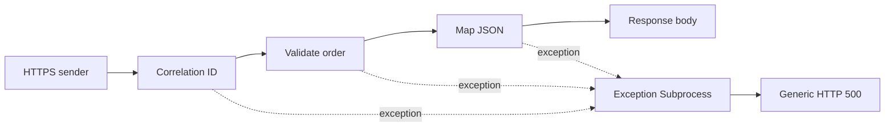

# SAP Integration Developer Portfolio
### Cloud Integration (CPI) · SAP Integration Suite · PI/PO migration design

A small, reviewable integration example by [Bernard Bieniek](https://www.linkedin.com/in/bernard-bieniek/).

This repository demonstrates order validation, JSON mapping, correlation and controlled error responses. It also documents how a comparable PI/PO scenario could be assessed for migration to Cloud Integration.

**Evidence level:** source examples and design documentation. No deployed iFlow export, tenant execution results or completed PI/PO migration are claimed.

## Start here

| Review path | Evidence |
| --- | --- |
| Understand the scenario | [Architecture and decisions](ARCHITECTURE.md) |
| Inspect the code | [Validation](ValidateOrder.groovy) · [Mapping](MapOrderToJson.groovy) · [Correlation](SetCorrelationId.groovy) · [Errors](CreateErrorResponse.groovy) |
| Reproduce the example | [Setup and verification](TESTING.md) |
| Discuss PI/PO and modernization | [Migration design study](PI-PO-MIGRATION.md) |

## Scenario: incoming order to receiver contract

A caller sends a JSON order. The flow retains or generates a correlation ID, validates the contract and maps it to a receiver-facing JSON structure.



The receiver adapter and actual business-system delivery are outside this demo. A synchronous HTTPS flow can return the mapped body for inspection.

## Example contract

Input: [order.json](order.json)

```json
{"orderId":"DEMO-1001","items":[{"sku":"PRODUCT-A","quantity":2},{"sku":"PRODUCT-B","quantity":1}]}
```

Output: [mapped-order.json](mapped-order.json)

```json
{"externalId":"DEMO-1001","lines":[{"productCode":"PRODUCT-A","quantity":2},{"productCode":"PRODUCT-B","quantity":1}]}
```

## Engineering choices

- Validate before mapping; reject missing identifiers and non-positive or fractional quantities.
- Keep correlation in a header and exchange property.
- Return a generic error body without exposing the payload or exception text.
- Keep scripts small and independently reviewable.
- Document retry and duplicate-delivery risks rather than implying exactly-once processing.

## Runtime and limits

Uses the classic `com.sap.gateway.ip.core.customdev.util.Message` API, intended for Script 1.x. Script 2.x requires an explicit compatibility review and updated imports.

The JSON body is materialized in memory. This example targets small payloads. It does not implement authentication, schema validation, retries, persistence, idempotency or a deployed receiver connection. All handled exceptions currently produce HTTP 500; see the design notes before extending it.

## Portfolio status

| Artifact | Status |
| --- | --- |
| Four Groovy scripts and sample payloads | Included |
| Architecture, deployment instructions and negative test matrix | Included |
| PI/PO migration study | Design only |
| Automated runtime tests / tenant validation | Not yet executed |
| Exportable SAP integration package | Not yet included |

Next useful additions: tenant test evidence with sanitized monitoring screenshots, a versioned iFlow export, and a receiver scenario with a tested idempotency policy.

[LinkedIn](https://www.linkedin.com/in/bernard-bieniek/) · [GitHub profile](https://github.com/Bernard-bk)

Demonstration content only. No customer data, credentials or production artifacts are included.

